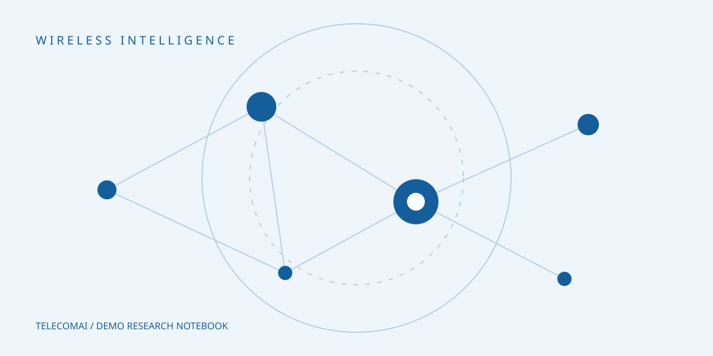

This is a **fictional research story** for exploring the TelecomAI website. It illustrates how a lab might explain an experiment without claiming new scientific results.

## Begin with a question

Before choosing a learning algorithm, decide which decision the controller must make. A useful toy question is: *which user should receive the next available resource block?* Keep the traffic trace small enough to inspect by hand.

Our demonstration objective balances useful throughput and resource cost:

$$
J(\pi) = \mathbb{E}\left[\sum_{t=0}^{T} \gamma^t \left(R_t - \lambda E_t\right)\right].
$$

Here $R_t$ is a reward, $E_t$ is an energy penalty, and $\lambda$ controls their trade-off. This expression is illustrative; it does not describe a validated lab result.

## Make the baseline understandable

A deterministic policy makes a useful first comparison. This JavaScript example chooses the largest observed queue, using the original order to break ties.

```javascript
function chooseQueue(queues) {
  if (queues.length === 0) return null;
  return queues.reduce((best, queue) =>
    queue.backlog > best.backlog ? queue : best
  );
}
```

Record the input trace and configuration alongside the output. The [demo resource collection](/mare) includes small synthetic files to try this workflow.



## Report what changed

A compact table can make experimental assumptions easier to compare:

| Decision | Starting point | Sensitivity check |
| --- | --- | --- |
| Channel trace | Fixed synthetic trace | Alternate seed |
| Scheduling interval | Fixed | Two interval lengths |
| Energy penalty | Documented coefficient | Small parameter sweep |

> A useful experiment is one whose assumptions another researcher can find and question.

For a short companion checklist, read [our note on reproducible runs](/notes/reproducible-runs). Author links above lead to the existing People records.
